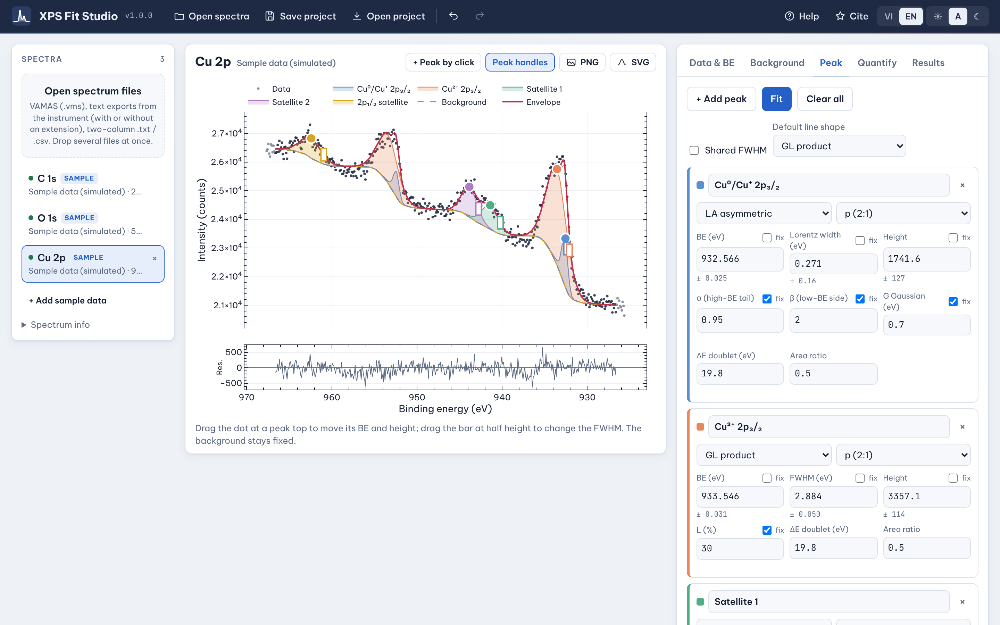

# XPS Fit Studio

**X-ray photoelectron spectroscopy (XPS) processing and peak fitting, right in your browser. Free, offline-capable, and your data never leaves your computer.**

[](https://lephong2810.github.io/XPSFitStudio/)
[](xpsfit/LICENSE)
[](https://github.com/lephong2810/XPSFitStudio/stargazers)



XPS Fit Studio takes a spectrum from the instrument file to a fitted, quantified and documented result: calibrate the binding-energy scale, subtract the background, deconvolute the envelope into components, check χ² and the parameter uncertainties, compute atomic percentages, then export the numbers to Excel and the figure as PNG or SVG. No installation, no account, no license key.

👉 **Try it now: <https://lephong2810.github.io/XPSFitStudio/>**

---

## Features

- **Data in:**
  - VAMAS / ISO 14976 files (`.vms`), multi-block, kinetic- or binding-energy abscissa.
  - Labelled text exports with KE / BE / intensity (cps) columns and dwell time / number of sweeps (files without an extension work too).
  - Plain two-column TXT / CSV. Drag and drop several files at once.
- **Binding-energy calibration:** manual shift, or reference to a known line (e.g. C 1s = 284.8 eV), then apply the same shift to every region.
- **Backgrounds:**
  - Iterative Shirley, smart Shirley (kept below the data), two-parameter Tougaard U2, linear.
  - Intermediate anchor points split the region into joined segments (useful for Cu 2p, Ni 2p, Co 2p with satellites).
  - Drag anchors and end points on the plot to set background levels.
- **Line shapes:**
  - Gaussian–Lorentzian product GL(m) and sum (pseudo-Voigt).
  - Asymmetric LA(α, β, G) for metallic core levels and sp² carbon.
  - Spin–orbit doublets with presets for 2p, 3d and 4f levels (fixed splitting and area ratio, shared width).
  - Shared FWHM across components; fix any parameter.
- **Fitting and statistics:**
  - Levenberg–Marquardt least squares with Poisson weighting.
  - χ², reduced χ², R², RMSE and a residual panel.
  - 1σ uncertainties of every parameter and of each component area, from the covariance matrix scaled by the reduced χ².
- **Hands-on editing:** drag a peak top to move its position and height, drag its half-height bar to change its width. Each tab enables only its own handles, so editing peaks never disturbs the background.
- **Quantification:**
  - Atomic % from background-subtracted areas in cps divided by relative sensitivity factors.
  - A Scofield (Al Kα) reference table is built in; you can enter your instrument's RSFs instead, with an optional KE<sup>n</sup> IMFP correction.
  - Component-level atomic percentages.
- **Output:**
  - [SciPlot Studio](https://github.com/lephong2810/SciPlotStudio) project (`.sciplot.json`): each spectrum opens as an XPS graph with filled peaks and its data workbook, ready for journal styling and multi-panel figures.
  - CSV, one file per spectrum.
  - Excel workbook with BE, raw data, background, envelope, each component and the residual, ready to re-plot.
  - Fit parameters with uncertainties, a quantification sheet and the Methods text.
  - Copy data to the clipboard.
  - Publication-style figure export (PNG at 600 dpi or vector SVG).
- **Methods text generator:** an English paragraph that states the software version, calibration, background, line shapes, constraints, reduced χ² and quantification settings, ready for the Experimental section.
- **Projects:**
  - Save and open `.xpsfit.json` project files.
  - Automatic session restore and full undo/redo.
- **Private and offline:**
  - All computation runs locally in your browser. Nothing is uploaded.
  - Install it as an app on macOS, Windows, Linux, iPad or Android; after the first visit it works without internet.
- **English / Tiếng Việt interface** with the **VI | EN** toggle, plus light and dark themes.

## Quick start

1. Open <https://lephong2810.github.io/XPSFitStudio/>. Three simulated example regions (C 1s, O 1s, Cu 2p) are loaded so you can try every step.
2. **Open spectra** (or drag files onto the left column). Example files are in [`xpsfit/examples/`](xpsfit/examples/).
3. Work through the tabs:
   - **Data & BE:** check the intensity unit and acquisition time, calibrate the BE scale, then *Apply to all spectra*.
   - **Background:** set the region and background type; add anchors where needed.
   - **Peak:** add components, choose line shapes and doublets, press **Fit** (Ctrl/⌘ Enter), and fine-tune by dragging the handles.
   - **Quantify:** choose an RSF for each region.
   - **Results:** check χ² and the uncertainties, export to SciPlot Studio, Excel or CSV, save the figure, and copy the Methods text.

**Install as an app:**
- *Chrome / Edge:* use the **Install app** button in the toolbar or the install icon in the address bar.
- *Safari on macOS 14+:* File → Add to Dock.
- *iPad / iPhone:* Share → Add to Home Screen.

| Shortcut | Action |
|---|---|
| Ctrl/⌘ Z · Y | Undo · redo |
| Ctrl/⌘ S · O | Save · open project (`.xpsfit.json`) |
| Ctrl/⌘ Enter | Fit |
| 1 – 5 | Switch tabs |

## Methods and validation

- χ² = Σ (y<sub>obs</sub> − y<sub>fit</sub>)² / σ² with σ² = counts. Intensities in cps are converted with the acquisition time (dwell × scans) for the weighting.
- Uncertainties are 1σ values from (JᵀWJ)⁻¹ × χ²<sub>red</sub>. The background is held fixed, so they do not include the effect of the background choice.
- Component areas are integrated over the analysis region.
- `xpsfit/tests/test_core.js` checks the engine on simulated spectra with Poisson noise. It covers recovery of peak positions, reduced χ² ≈ 1, agreement between covariance errors and Monte Carlo scatter, the LA line shape, the Shirley background, quantification and file parsing. Run it with `node xpsfit/tests/test_core.js`.
- For publications, also report the background type and region, the line shapes and constraints, and the BE reference. The Methods text generator does this for you. Cross-checking a few spectra against another established fitting package is good practice.

## Repository layout

```
index.html             redirect to the web app
xpsfit/
├── docs/              the web app (GitHub Pages): index.html, app.js, core.js, i18n.js, styles.css, sw.js …
│   ├── vendor/        Plotly.js and SheetJS (bundled for offline use)
│   ├── fonts/         Be Vietnam Pro and JetBrains Mono
│   └── HUONG_DAN_GITHUB.md   Vietnamese guide: publishing and updating
├── examples/          simulated example files (.vms, text export, .csv)
├── tests/             engine tests (Node.js)
├── gallery/           screenshot
├── build_docs.py      stamps a new app version after edits
├── CITATION.cff       citation metadata
├── LICENSE            MIT
└── THIRD_PARTY_NOTICES.md
```

After editing anything in `xpsfit/docs/`, run `python xpsfit/build_docs.py` before pushing so installed apps pick up the update.

## Support the project and cite it

XPS Fit Studio is free for everyone. If you find it useful:

- ⭐ **Star this repository.** It helps other researchers find the tool.
- **Acknowledge XPS Fit Studio** in your papers, theses and reports. Copy-ready sentences are also in the app under **Cite**.

> **Acknowledgments:** The authors thank Dr. Phong Hoai Le (University of Science, VNU-HCM, Vietnam) for developing XPS Fit Studio (https://github.com/lephong2810/XPSFitStudio), which was used to process the XPS spectra in this work.

> **Methods / Experimental:** XPS spectra were processed using XPS Fit Studio (version 1.0.0; P. H. Le, University of Science, VNU-HCM, Vietnam; https://github.com/lephong2810/XPSFitStudio).

> **Figure caption / SI:** Fitted with XPS Fit Studio v1.0.0 (https://github.com/lephong2810/XPSFitStudio).

> **Reference (ACS style):** Le, P. H. *XPS Fit Studio*, version 1.0.0; University of Science, VNU-HCM: Ho Chi Minh City, Vietnam, 2026. https://github.com/lephong2810/XPSFitStudio.

GitHub's **"Cite this repository"** button (from `xpsfit/CITATION.cff`) also gives APA and BibTeX formats.

## Feedback

Found a bug or have a feature request? Please open an [issue](https://github.com/lephong2810/XPSFitStudio/issues). Example files that reproduce the problem are very welcome; please share only data you are allowed to share.

## License and notices

- XPS Fit Studio is released under the [MIT License](xpsfit/LICENSE). © 2026 Phong Hoai Le.
- It bundles Plotly.js (MIT), SheetJS Community Edition (Apache-2.0) and the Be Vietnam Pro and JetBrains Mono fonts (SIL OFL 1.1); see [THIRD_PARTY_NOTICES.md](xpsfit/THIRD_PARTY_NOTICES.md).
- The built-in sensitivity factors are Scofield cross-sections (Al Kα) for reference only; use the factors of your own instrument where available.
- XPS Fit Studio is an independent project and is not affiliated with, sponsored by, or endorsed by any instrument manufacturer or software vendor. All trademarks belong to their respective owners.
- All data in the bundled examples and in the screenshot are simulated.

---

<sub>Developed by Phong Hoai Le · Faculty of Chemistry, University of Science, Vietnam National University Ho Chi Minh City.</sub>
